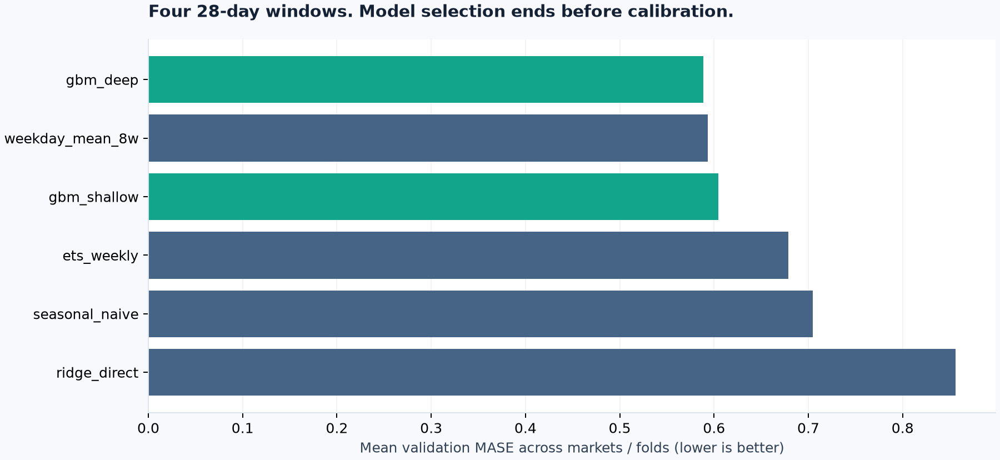
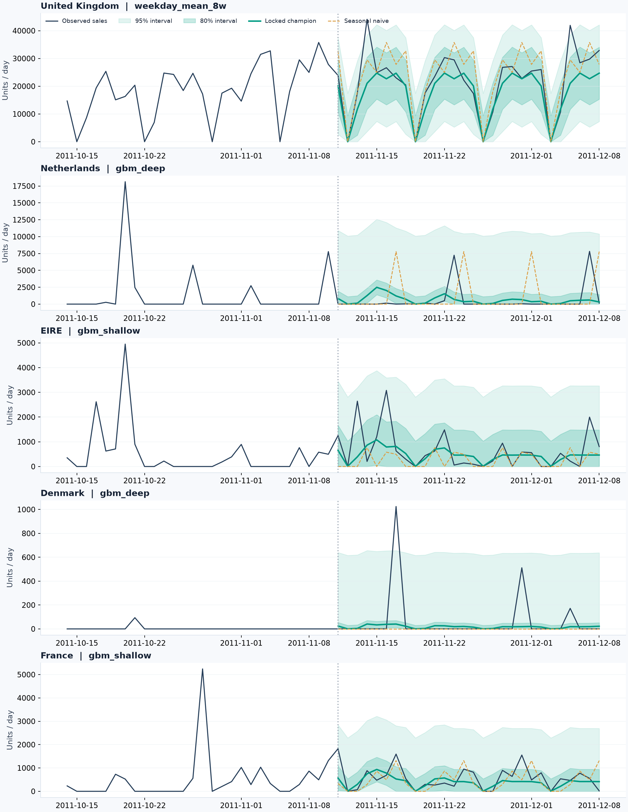
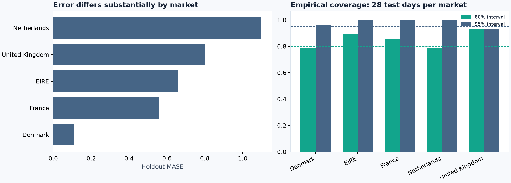

# RetailCast — báo cáo kết quả thực nghiệm

## 1. Bài toán và phạm vi
Dự báo tổng số đơn vị hàng hóa bán ra mỗi ngày cho 5 thị trường, horizon 28 ngày.
Kết quả hỗ trợ thảo luận lập kế hoạch tải vận hành; không tự động chuyển thành mức đặt hàng tồn kho.
Nguồn: [UCI Online Retail II](https://archive.ics.uci.edu/dataset/502/online+retail+ii), DOI 10.24432/C5CG6D, CC BY 4.0.
Dữ liệu lịch sử 2009-12-01 → 2011-12-08; 1,067,371 dòng gốc.
Đây là bài thực nghiệm trên dữ liệu lịch sử, không phải dự báo bán hàng hiện tại.

## 2. Thiết kế đánh giá
- 4 fold validation, mỗi fold dự báo cố định 28 ngày; huấn luyện mở rộng theo thời gian.
- Chọn thuật toán riêng cho từng thị trường bằng MASE trung bình trên 4 fold.
- 2 fold tiếp theo dùng riêng để hiệu chỉnh khoảng dự báo (56 sai số / thị trường).
- Holdout: 2011-11-11 → 2011-12-08. Khóa lựa chọn trước khi chấm điểm.
- Nhãn huấn luyện phải có target_date trước cutoff; toàn bộ lag và rolling chỉ lấy dữ liệu đã biết tại origin.
- Không cập nhật bằng actual trong 28 ngày đang dự báo. Không dùng random split hoặc early stopping ngẫu nhiên.

## 3. Kết quả holdout
WAPE của bộ champion: **26.6%**; seasonal naive: **35.4%**.
Thay đổi tương đối WAPE so với seasonal naive: **+24.9%** (số dương là giảm lỗi).
Đây là kết quả một cửa sổ 28 ngày; không chứng minh cải thiện ổn định qua mọi mùa.

| model | MAE | RMSE | WAPE | MASE | bias_pct |
| --- | --- | --- | --- | --- | --- |
| selected_champion | 1,246.430 | 3,285.374 | 26.6% | 0.645 | -17.3% |
| weekday_mean_8w | 1,334.880 | 3,359.131 | 28.5% | 0.746 | -15.7% |
| seasonal_naive | 1,659.064 | 3,660.774 | 35.4% | 0.867 | 11.0% |

WAPE cộng gộp bị chi phối bởi thị trường lớn. MASE trung bình cân bằng số quan sát giữa thị trường.
MASE dùng thang đo seasonal naive trong tập train; MASE < 1 không tự động chứng minh thắng seasonal naive trên test.

### Theo thị trường
| market | model | MAE | RMSE | WAPE | MASE | bias_pct |
| --- | --- | --- | --- | --- | --- | --- |
| Netherlands | selected_champion | 1,039.440 | 2,009.867 | 180.9% | 1.099 | 9.7% |
| Denmark | selected_champion | 73.033 | 210.966 | 119.7% | 0.109 | -71.2% |
| EIRE | selected_champion | 457.256 | 745.805 | 71.0% | 0.658 | -28.2% |
| France | selected_champion | 315.116 | 456.783 | 56.2% | 0.559 | -29.3% |
| United Kingdom | selected_champion | 4,347.304 | 7,008.528 | 20.2% | 0.800 | -17.2% |
| United Kingdom | weekday_mean_8w | 4,347.304 | 7,008.528 | 20.2% | 0.800 | -17.2% |
| Netherlands | weekday_mean_8w | 1,370.652 | 2,511.854 | 238.5% | 1.449 | 52.0% |
| EIRE | weekday_mean_8w | 576.723 | 880.117 | 89.6% | 0.830 | -23.9% |
| Denmark | weekday_mean_8w | 90.661 | 211.852 | 148.5% | 0.136 | -28.0% |
| France | weekday_mean_8w | 289.062 | 412.843 | 51.5% | 0.513 | -18.3% |
| United Kingdom | seasonal_naive | 5,650.036 | 7,295.649 | 26.2% | 1.040 | 12.0% |
| Netherlands | seasonal_naive | 1,676.643 | 3,556.209 | 291.8% | 1.773 | 93.5% |
| EIRE | seasonal_naive | 532.000 | 891.551 | 82.7% | 0.766 | -59.2% |
| Denmark | seasonal_naive | 61.036 | 218.955 | 100.0% | 0.091 | -100.0% |
| France | seasonal_naive | 375.607 | 538.904 | 66.9% | 0.666 | -16.0% |

Champion thua seasonal naive tại: **Denmark**.
Champion thua baseline trung bình theo thứ tại: **France**.
Các thị trường có WAPE champion vượt 100%: **Denmark, Netherlands**.
Không diễn giải chỉ số tổng hợp tốt thành chất lượng tốt ở mọi thị trường. Đặc biệt, denominator MASE lớn do đơn đột biến trong train có thể làm MASE thấp dù dự báo trên một thị trường bán thưa vẫn yếu.
Lựa chọn thuật toán giữ nguyên sau khi thấy các kết quả này.

### Khoảng dự báo
| market | n | coverage_80 | width_80 | interval_score_80 | coverage_95 | width_95 | interval_score_95 |
| --- | --- | --- | --- | --- | --- | --- | --- |
| Denmark | 28.000 | 78.6% | 46.024 | 605.232 | 96.4% | 632.857 | 1,160.273 |
| EIRE | 28.000 | 89.3% | 1,475.726 | 2,557.347 | 100.0% | 3,262.008 | 3,262.008 |
| France | 28.000 | 85.7% | 885.343 | 1,563.658 | 100.0% | 2,674.264 | 2,674.264 |
| Netherlands | 28.000 | 78.6% | 1,622.505 | 6,619.096 | 100.0% | 10,712.482 | 10,712.482 |
| United Kingdom | 28.000 | 92.9% | 17,411.411 | 26,415.161 | 92.9% | 31,538.554 | 44,569.625 |

Khoảng dùng sai số tuyệt đối và hiệu chỉnh thứ hạng ceil((n+1) × coverage), cắt cận dưới tại 0.
Không gọi đây là bảo đảm độ phủ: sai số có phụ thuộc thời gian, quy mô bán có thể thay đổi, và holdout gần mùa Giáng sinh.
Khoảng được gộp qua 28 horizon cho từng thị trường; không có bảo đảm riêng cho từng horizon hoặc tổng 28 ngày.
Không cộng các cận ngày để tuyên bố khoảng tin cậy cho tổng bán 28 ngày.

## 4. Kiểm tra chất lượng và giới hạn
- Loại hủy đơn, số lượng/giá không dương, mã không phải hàng hóa; giữ đơn lớn để không làm đẹp dữ liệu.
- Không bỏ giao dịch chỉ vì thiếu Customer ID: biến này không cần cho target tổng bán.
- Loại bản ghi trùng hoàn toàn theo giả định lỗi ghi nhận; không có line ID để xác nhận mọi trường hợp.
- Bỏ ngày cuối vì ghi nhận chưa trọn ngày. Ngày không có giao dịch hợp lệ được gán 0, có thể lẫn với mất dữ liệu.
- Thị trường được chọn bằng dữ liệu trước validation đầu tiên, tránh chọn theo kết quả tương lai.
- Chưa có giá/khuyến mại/tồn kho/lead time; không suy luận nhu cầu bị mất do hết hàng hoặc tác động nhân quả.
- Ít hơn 3 năm dữ liệu và chỉ 1 holdout: hạn chế đánh giá mùa vụ năm, cold start, structural breaks.
- Nhiều khách là wholesaler; đơn lớn tạo sai số đột biến. Các lỗi lớn được giữ trong largest_errors.csv.

## 5. Hướng nâng cấp hợp lý
Thêm tồn kho, lịch khuyến mại và lịch nghỉ theo thị trường; kiểm tra nhiều mùa holdout theo protocol mới đã định trước;
so sánh mô hình phân cấp SKU → thị trường nếu có master data; dùng block calibration hoặc rolling quantile với nhiều lịch sử hơn.
Chỉ đánh giá chính sách tồn kho khi có lead time và chi phí thiếu/dư hàng thực.

## 6. Tái lập
Xem README.md. File run_summary.json ghi cấu hình, phiên bản thư viện, SHA-256 dữ liệu và thời gian chạy.
Kết quả có thể lệch nhỏ giữa phiên bản BLAS/nền tảng. Chạy tests trước khi dùng để trình bày.

